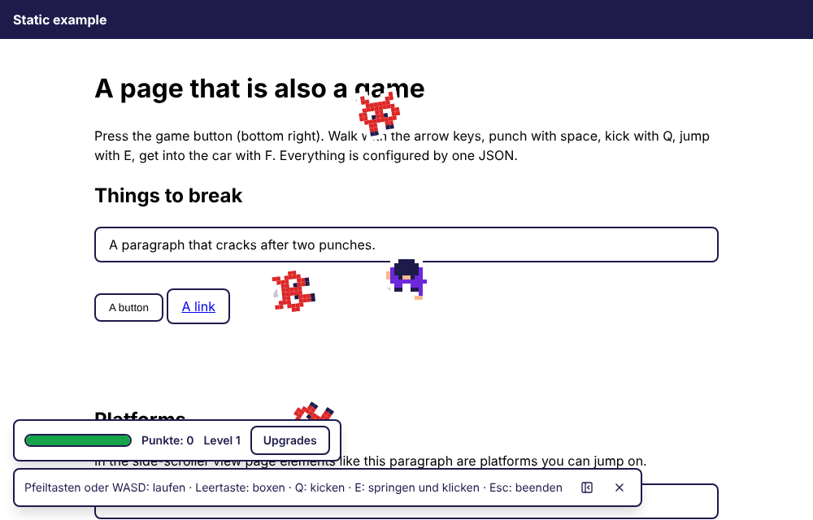
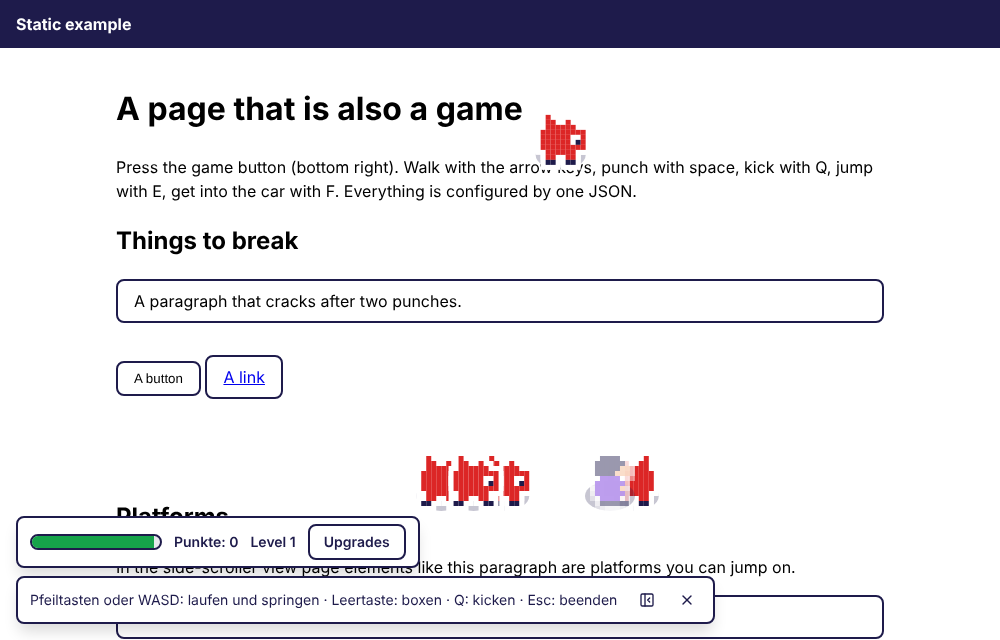
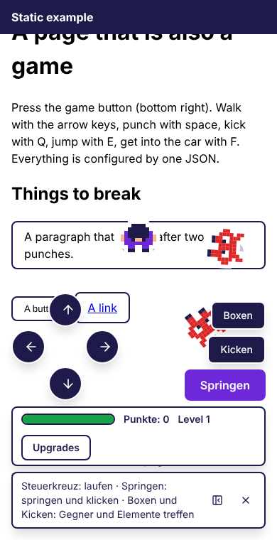

# hello-eme-play

Turns **any website into a game**, configured by **one JSON**. The page itself is the playing field: the
visitor walks over it, punches paragraphs until they break, fights monsters, jumps on cards and drives a car.
It works with plain HTML, any framework and any CMS. An editor (one script, no framework) and a Payload plugin
change the JSON; try it in the [live demo](https://oldjazjef.github.io/hello-eme-play/): guide, editor and live preview.



## What it can do

- **Two views:** top-down and side-scroller (the figure and monsters are drawn in profile; page elements are platforms), switchable at any time by items, triggers or levels.
- **Figure, monsters, vehicles:** every one has stats (health, attack, speed, …), moves (punch, kick, bite) and a behavior (chase, wander, flee).
- **Levels and goals:** score, kills, survive for some time or defeat a boss.
- **Wave scripts and boss phases:** "at 10 s three blobs, at 25 s a swarm, at 40 s the boss"; a boss enrages or summons help when its health falls below a share.
- **Per-page settings:** `/blog` can be top-down and `/projects` a side-scroller, with other monsters; the game follows the visitor's navigation.
- **Items, upgrades and a shop**, **triggers** ("when X happens, if Y holds, do Z"), sounds and a high score.
- **Own pictures:** pixel art is built in; your own PNG or SVG sprite sheets with animations replace it.
- **Touch controls:** d-pad, round action buttons, steering wheel and pedals for the car.
- **Safe by design:** the JSON is always validated; wrong values are corrected, never crash the page.
- **An editor for the JSON:** quick settings, presets, a balance check, a live preview, a flow view and a guide, on any page or in Payload.



| Package                                       | Purpose                                                              |
| --------------------------------------------- | -------------------------------------------------------------------- |
| [`@hello-eme/play`](packages/play)            | Browser runtime and drop-in script                                   |
| [`@hello-eme/play-core`](packages/core)       | Game logic without a DOM (entities, events, RNG)                     |
| [`@hello-eme/play-schema`](packages/schema)   | The JSON as data: defaults, validation, migrations, JSON Schema      |
| [`@hello-eme/play-editor`](packages/editor)   | The configuration editor for any page (one script), React export too |
| [`@hello-eme/play-payload`](packages/payload) | Payload CMS plugin: the same editor inside the Payload admin         |
| [`@hello-eme/play-sim`](packages/sim)         | Headless bots for balancing (`play-sim`)                             |
| [`examples/static`](examples/static)          | A plain HTML page with the game and Playwright tests (not published) |

## Get started in 5 minutes

**1. Add the script to your page.** Download `play.js` from the [latest release](https://github.com/oldjazjef/hello-eme-play/releases/latest) and put it next to your page (GitHub serves release files as downloads, so host it yourself):

```html
<script src="/play.js" data-config="{}" defer></script>
```

`{}` is a complete game: the classic one with all defaults.

**2. Start it.** The script adds a floating game button by itself (`data-toggle="off"` turns that off). Any button of yours can start and stop the game too:

**Preview in the CMS.** A page for the admin's live preview loads the script with `data-preview="https://cms.example.com"` (the admin's origin). It then plays whatever configuration the admin sends and starts a fresh round on every change; messages from other origins are ignored.

```html
<button type="button" data-play-toggle>Play</button>
```

**3. Change the game.** Everything is optional and merged over the defaults. Stronger monsters, a second level in the side view, a heart that heals:

```html
<script
	src="/play.js"
	data-config='{
		"levels": [
			{ "label": "Warm-up", "goal": { "type": "kills", "amount": 3 } },
			{ "label": "Heat", "view": "side", "goal": { "type": "survive", "amount": 30 } }
		],
		"items": { "heart": { "look": "heart", "do": [{ "do": "heal", "amount": 30 }] } },
		"entities": { "blob": { "stats": { "hp": 4, "speed": 90 }, "reward": { "points": 100, "drops": [{ "item": "heart", "chance": 30 }] } } }
	}'
	defer
></script>
```

For a longer JSON load a file instead: `<script src="/play.js" data-config-url="/play.json" defer></script>`.
Every setting is explained in [docs/CONFIG.md](docs/CONFIG.md), with a cookbook. The JSON Schema
(`@hello-eme/play-schema/play.schema.json`) gives autocompletion in editors.

**4. Try the finished example:** [examples/static](examples/static) is a plain HTML page with the game.

```sh
npm install && npm run build
node examples/static/serve.mjs      # open the printed URL, press the game button
```

### Controls

| Action               | Keyboard           | Touch                    |
| -------------------- | ------------------ | ------------------------ |
| Walk / steer the car | Arrow keys or WASD | d-pad / wheel and pedals |
| Punch (drift in car) | Space              | "Boxen"                  |
| Kick                 | Q                  | "Kicken"                 |
| Jump (honk in car)   | E                  | "Springen"               |
| Get in / out of car  | F                  | on the car               |
| Shop                 | U                  | "Upgrades"               |
| Quit                 | Esc                | close button             |

All keys can be changed in the JSON (`keys` for walking, jumping, using and the shop, `moves.<id>.keys` for punch and kick). Texts are German or English (`locale`) and can be overridden (`texts`).



## Use it in your project

| You have                 | Do this                                                                                                    |
| ------------------------ | ---------------------------------------------------------------------------------------------------------- |
| A plain HTML page        | The script tag above.                                                                                      |
| A bundler or a framework | `import { createPlay } from '@hello-eme/play'; createPlay({ config }).start();` ([package](packages/play)) |
| No CMS, but want to edit | The standalone editor: one script, one call ([package](packages/editor), [example](examples/editor)).      |
| Payload CMS 3            | The plugin, so editors change the game in the admin ([package](packages/payload), steps below).            |
| A server or a build step | Validate JSON with `resolveConfig` / `configProblems` from `@hello-eme/play-schema`.                       |

### Install with npm or without

The packages are on every [GitHub release](https://github.com/oldjazjef/hello-eme-play/releases) as tarballs; no npm account or token is needed. Details: [docs/INSTALL.md](docs/INSTALL.md).

```sh
BASE=https://github.com/oldjazjef/hello-eme-play/releases/download/v0.1.1
npm install $BASE/hello-eme-play-0.1.1.tgz          # engine (with core and schema)
npm install $BASE/hello-eme-play-payload-0.1.1.tgz  # Payload plugin
```

To update, install the URL of a newer release.

### Edit the game in the Payload admin

1. Install `@hello-eme/play-payload` (above); it needs `payload`, `@payloadcms/ui` and `react`.
2. Register the plugin in `payload.config.ts`:

   ```ts
   import { playPlugin } from '@hello-eme/play-payload';

   export default buildConfig({
   	plugins: [playPlugin({ mediaCollection: 'media' })]
   });
   ```

3. Run `payload generate:importmap` once. The admin now has a **Play** global with a form for every
   setting (German or English), presets, a picture picker and a raw JSON tab.
4. Let the website read the global (server side) and start the game with it:

   ```ts
   const { config } = await (await fetch(`${CMS_URL}/api/globals/play`)).json();
   createPlay({ config }).start();
   ```

   An old `@hello-eme/page-game` JSON is migrated automatically.

### Edit the game without a CMS

The same editor that runs in Payload also runs on any page: quick settings, presets with a live preview,
a balance check, the full form, a flow of what triggers what, a guide, undo and redo.

```html
<div id="editor"></div>
<script src="editor.js"></script>
<script>
	PlayEditor.mount(document.getElementById('editor'), {
		value: await (await fetch('/play.json')).json(),
		onChange: (json) => save(json)
	});
</script>
```

Details and options: [packages/editor](packages/editor). A live demo (guide, editor, live preview) is built from [site/](site) and published with GitHub Pages. Every setting, key, event and action is listed in
the [configuration reference](docs/REFERENCE.md) ([Deutsch](docs/REFERENCE.de.md)), which is generated from the schema.

### Waves, bosses and other pages

```json
{
	"waves": [
		{
			"label": "Raid",
			"steps": [
				{ "at": 10, "do": [{ "do": "spawn", "entity": "blob", "count": 3 }] },
				{
					"at": 25,
					"every": 5,
					"repeat": 2,
					"do": [{ "do": "spawn", "entity": "blob", "count": 8 }]
				},
				{ "at": 40, "do": [{ "do": "spawn", "entity": "king" }] }
			]
		}
	],
	"entities": {
		"king": {
			"kind": "monster",
			"boss": true,
			"phases": [
				{ "below": 50, "label": "Enraged!", "stats": { "attack": 10 } },
				{ "below": 25, "do": [{ "do": "spawn", "entity": "blob", "count": 4 }] }
			]
		}
	},
	"pages": [
		{ "match": "/projects", "config": { "view": { "mode": "side" } } },
		{ "match": "/blog/*", "config": { "view": { "mode": "topdown" } } }
	]
}
```

A wave runs actions on a timeline (`at` seconds after it starts, `every` and `repeat` for repeats). A boss
phase fires once when its health falls below `below` percent. `pages` entries are merged over the base
configuration in order for the visitor's path; the game follows navigation, and `play.setPath(path)` is there for
frameworks that prefer to say so. All of it is explained in [docs/CONFIG.md](docs/CONFIG.md).

### Balance without a browser

```sh
npx play-sim preset:arcade --rounds 20 --bot brawler
```

Bots play your JSON headless and report win and death rates, scores and hints such as "nobody survives" or "too easy" ([package](packages/sim)).

Presets (`PRESETS` in the schema package): `classic`, `arcade` (levels, items, upgrades, a boss),
`platformer` (side view) and `view-switch` (an item changes the view). A JSON that switches between the
views on a timer: [docs/examples/view-switch.json](docs/examples/view-switch.json).

## Develop

The screenshots above come from `node scripts/screenshots.mjs` (after `npm run build`, needs Chromium).

```sh
npm install
npm run verify   # format check + lint + check + test + build
npm run e2e      # Playwright against the example page and the demo site (needs chromium)
npm run docs     # regenerate docs/REFERENCE.md from the schema (a test fails when it is stale)
```

The demo site (`site/`: editor with live preview, guide, a page that plays your configuration) is built with
`node scripts/build-site.mjs` after `npm run build` and published by GitHub Pages from `main`
(Settings → Pages → Source: GitHub Actions).

Node 22. Nx + npm workspaces. Commits follow Conventional Commits (commitlint, husky). Changes to a
published package need a changeset: `npm run changeset`.

## License

MIT
